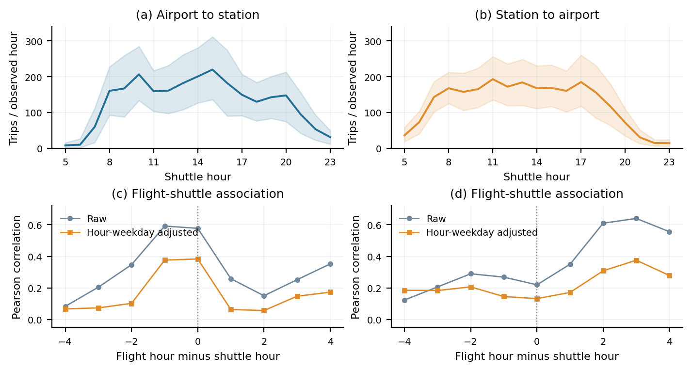

# 1. Gli orari dei voli aiutano a prevedere l’uso del Marconi Express?

### Il collegamento tra aeroporto e stazione di Bologna

- **Obiettivo:** prevedere quanti viaggi saranno effettuati ogni ora, nelle due direzioni.
- **Domanda:** conoscere i voli serve davvero, oltre a sapere l’ora e il giorno della settimana?
- **Seconda domanda:** serve anche stimare quanti passeggeri trasporta ogni volo?

> Risposta in breve: contare i voli aiuta; stimarne i passeggeri aggiunge poco, in questo studio.

---

# 2. Quali dati sono stati utilizzati?

- **Voli:** circa 192 mila movimenti, dal 2023 al 10 luglio 2025.
- **Navetta:** conteggi orari separati per aeroporto → stazione e stazione → aeroporto.
- I dati della navetta coprono **solo alcuni mesi**; le ore mancanti non sono considerate pari a zero.
- Il test riguarda solo **ore registrate di servizio ordinario**, non tutte le condizioni di servizio.

<!-- Lettura: a sinistra i passeggeri aerei mensili; a destra la percentuale di ore registrate nei mesi disponibili. Luglio 2025 contiene solo dieci giorni di dati aeroportuali. I servizi sostitutivi non hanno conteggi direzionali e non vengono sommati alla navetta. Si contano viaggi, non persone uniche. -->

---

# 3. Le due direzioni hanno ritmi diversi

- Verso la **stazione**, il massimo medio giornaliero è intorno alle **15:00**.
- Verso l’**aeroporto**, è intorno alle **11:00**.
- Il legame più forte è con gli arrivi vicini all’ora della navetta e con le partenze **circa tre ore dopo**.

<!-- In alto: andamento medio e variabilità dei viaggi. In basso: associazione tra passeggeri aerei e viaggi in navetta, anche dopo aver tolto i ritmi ricorrenti di ora e giorno della settimana. Sono relazioni aggregate: non dimostrano che le stesse persone abbiano preso volo e navetta, né misurano i tempi individuali di trasferimento. -->

---

# 4. Un confronto semplice e controllato

| Modello | Informazioni utilizzate |
| :--- | :--- |
| **CAL** | Calendario: ora, giorno della settimana, mese… |
| **SCHED** | Calendario + numero di voli programmati nelle ore vicine |
| **PAX** | Come SCHED + passeggeri stimati dalle medie dei voli passati |

- **Stesso metodo di previsione**, stessi dati di addestramento: cambia l’informazione aggiunta.
- Si impara dai dati precedenti a marzo 2025 e si verifica su **marzo–maggio 2025**, senza aggiornare i tre modelli.
- Il test comprende circa **1.490 ore per direzione**.

> Così si verifica se i dati sui voli aggiungono qualcosa al calendario.

<!-- Il metodo è gradient boosting. Le stime dei passeggeri non sono prenotazioni: sono medie storiche, calcolate prima del test e poi mantenute fisse. L’ultima storia disponibile della navetta per l’addestramento risale a settembre 2024. -->

---

# 5. Il risultato principale: basta già contare i voli

**Errore assoluto medio: di quanti viaggi si sbaglia, in media, ogni ora.**
Più basso è il valore, meglio è.

| Modello | Aeroporto → stazione | Stazione → aeroporto |
| :--- | ---: | ---: |
| CAL: calendario | 33,97 | 25,94 |
| SCHED: + voli | **31,02** | **24,97** |
| PAX: + passeggeri stimati | 30,86 | 24,85 |

- Aggiungere i voli riduce l’errore del **8,7%** verso la stazione e del **3,7%** verso l’aeroporto.
- Stimare anche i passeggeri aggiunge solo **circa lo 0,5%** di miglioramento in ciascuna direzione.
- Quest’ultimo piccolo vantaggio **non è statisticamente chiaro**: è compatibile anche con nessun beneficio.

<!-- Risultati aggregati di marzo–maggio, in viaggi/ora. Intervalli al 95% del guadagno SCHED su CAL: [4,1%; 12,6%] e [-0,2%; 7,4%]. Quindi anche il beneficio dei soli voli verso l’aeroporto è meno certo. Intervalli del guadagno PAX su SCHED: [-1,3%; 2,3%] e [-1,3%; 2,2%]. -->

---

# 6. Il vantaggio cambia da un mese all’altro

- Le barre rappresentano l’errore medio: **più basse = previsioni migliori**.
- PAX ha un errore inferiore a CAL in tutti e tre i mesi, ma ad **aprile il vantaggio è minimo**.
- Verso l’aeroporto, i miglioramenti sono più piccoli e meno certi.
- A maggio, una semplice media dei **conteggi recenti della navetta** batte PAX in entrambe le direzioni.

<!-- RECENT usa i 28 giorni precedenti e può ricevere conteggi dei giorni già conclusi durante il test; CAL, SCHED e PAX restano fissi. Non è quindi un confronto che isola il valore dei voli. A maggio, MAE RECENT 29,69 e 22,46; PAX 31,12 e 27,68. Tre mesi non bastano per generalizzare a tutte le stagioni. -->

---

# 7. Il punto debole: le ore davvero affollate

- Nelle ore di picco osservate, l’errore di PAX sale a circa **60 viaggi/ora verso la stazione** e **49 verso l’aeroporto**: quasi il doppio della media.
- In queste ore, la previsione è troppo bassa nel **96%** e nel **92%** dei casi.
- Ma nelle ore che il modello *prevede* più affollate, può anche sovrastimare: **picchi osservati e picchi previsti non coincidono**.

<!-- Figura: in alto si confrontano medie previste e osservate raggruppando per livello della previsione; in basso gli errori nelle ore con picchi osservati. Un errore negativo indica sottostima. Soglie dei picchi fissate sui dati di addestramento: 246 e 219 viaggi/ora. Selezionare a posteriori le osservazioni più alte seleziona anche sorprese verso l’alto: non dimostra una sottostima generale del modello. Esempio dell’andamento orario, 1–7 maggio: paper/figures/week.png. -->

---

# 8. Cosa ci portiamo a casa?

1. **Partire dal numero di voli:** produce quasi tutto il miglioramento rispetto al solo calendario.
2. **Non dare per scontato il valore di dati più complessi:** le stime storiche dei passeggeri aggiungono poco.
3. **Controllare separatamente direzioni, mesi e picchi:** un buon errore medio non basta.

**Limiti:** test retrospettivo di tre mesi, solo ore registrate di servizio ordinario; manca la verifica di quali dati sui voli fossero realmente disponibili in anticipo.

**Prima dell’uso operativo:** test dal vivo su più stagioni, archivi delle revisioni e cancellazioni dei voli, dati su interruzioni e capacità dei treni.

<!-- Fonte: paper/main.tex e le cinque figure del paper, tutte esaminate. Il lavoro non dimostra riduzioni di costi, code o numero di treni. Per queste conclusioni servono dati operativi e sulla distribuzione degli arrivi all’interno dell’ora. -->
