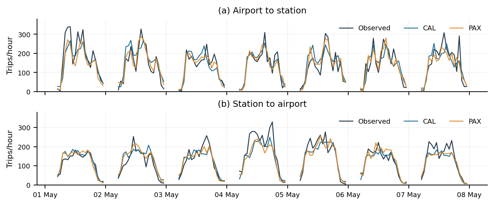
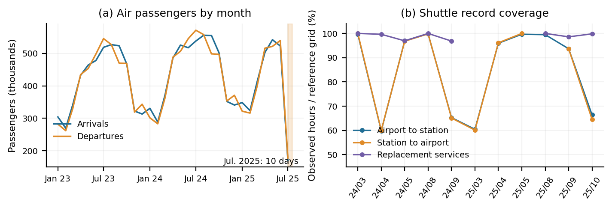
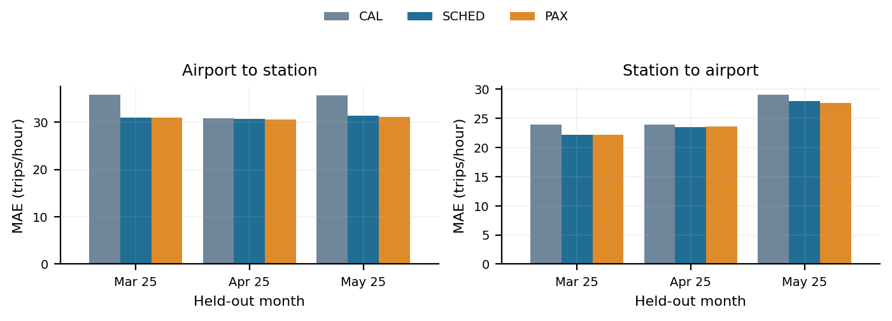
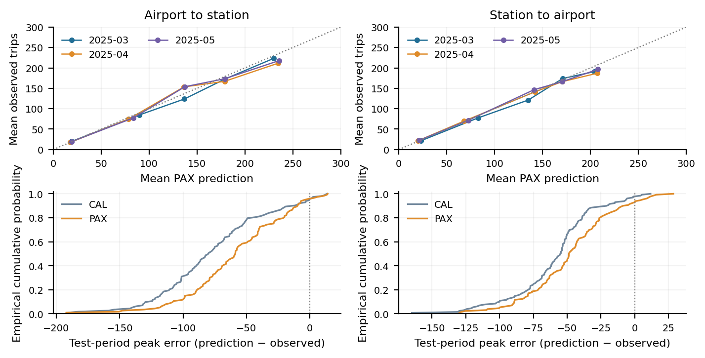

# 1. Il valore degli orari dei voli per prevedere la domanda oraria del Marconi Express

**Nicola Bicocchi e Marco Mamei**

Università degli Studi di Modena e Reggio Emilia

Prevediamo i viaggi orari tra l’aeroporto e la stazione di Bologna, in entrambe le direzioni.

- Quanto migliora la previsione aggiungendo al calendario il numero di voli programmati?
- Quanto si guadagna stimando anche i passeggeri di ciascun volo?

<!-- Nicola Bicocchi afferisce al Dipartimento di Ingegneria «Enzo Ferrari». Marco Mamei afferisce al Dipartimento di Scienze e Metodi dell’Ingegneria. -->

---

# 2. Quali dati sono stati utilizzati?

- **Voli:** circa 192 mila movimenti, dal 2023 al 10 luglio 2025.
- **Navetta:** conteggi orari separati per aeroporto → stazione e stazione → aeroporto.
- I dati della navetta coprono **solo alcuni mesi**; le ore mancanti non sono considerate pari a zero.
- Il test riguarda solo **ore registrate di servizio ordinario**, non tutte le condizioni di servizio.

<!-- Lettura: a sinistra i passeggeri aerei mensili; a destra la percentuale di ore registrate nei mesi disponibili. Luglio 2025 contiene solo dieci giorni di dati aeroportuali. I servizi sostitutivi non hanno conteggi direzionali e non vengono sommati alla navetta. Si contano viaggi, non persone uniche. -->

---

# 3. Le due direzioni hanno ritmi diversi

- Verso la **stazione**, il massimo medio giornaliero è intorno alle **15:00**.
- Verso l’**aeroporto**, è intorno alle **11:00**.
- Il legame più forte è con gli arrivi vicini all’ora della navetta e con le partenze **circa tre ore dopo**.

<!-- In alto: andamento medio e variabilità dei viaggi. In basso: associazione tra passeggeri aerei e viaggi in navetta, anche dopo aver tolto i ritmi ricorrenti di ora e giorno della settimana. Sono relazioni aggregate: non dimostrano che le stesse persone abbiano preso volo e navetta, né misurano i tempi individuali di trasferimento. -->

---

# 4. Come misuriamo il valore dei dati sui voli

| Modello | Informazioni utilizzate |
| :--- | :--- |
| **CAL** | Ora, giorno della settimana, mese e altri effetti di calendario |
| **SCHED** | CAL + numero di voli programmati nelle ore vicine |
| **PAX** | SCHED + passeggeri stimati dai conteggi di voli precedenti |

- **Addestramento** sui conteggi della navetta di marzo, aprile, maggio, agosto e settembre 2024. Per stimare i passeggeri si usano i dati dei voli fino a febbraio 2025.
- **Test** da marzo a maggio 2025, su circa 1.490 ore registrate per direzione. I tre modelli usano lo stesso algoritmo e restano fissi durante il test.

<!-- Il modello principale usa il gradient boosting. -->

---

# 5. Contare i voli dà quasi tutto il guadagno sul calendario

**Errore assoluto medio: di quanti viaggi si sbaglia, in media, ogni ora.**
Più basso è il valore, meglio è.

| Modello | Aeroporto → stazione | Stazione → aeroporto |
| :--- | ---: | ---: |
| CAL: calendario | 33,97 | 25,94 |
| SCHED: + voli | **31,02** | **24,97** |
| PAX: + passeggeri stimati | 30,86 | 24,85 |

- Aggiungere i voli riduce l’errore dell’**8,7%** verso la stazione e del **3,7%** verso l’aeroporto.
- Con le stime dei passeggeri, l’errore scende di un altro **0,5% circa** in ciascuna direzione. I dati sono compatibili con piccoli guadagni e piccoli peggioramenti.

<!-- Risultati aggregati di marzo–maggio, in viaggi/ora. Intervalli al 95% del guadagno SCHED su CAL: [4,1%; 12,6%] e [-0,2%; 7,4%]. Quindi anche il beneficio dei soli voli verso l’aeroporto è meno certo. Intervalli del guadagno PAX su SCHED: [-1,3%; 2,3%] e [-1,3%; 2,2%]. -->

---

# 6. Il vantaggio cambia da un mese all’altro

- Le barre rappresentano l’errore medio: **più basse = previsioni migliori**.
- PAX ha un errore inferiore a CAL in tutti e tre i mesi, ma ad **aprile il vantaggio è minimo**.
- Verso l’aeroporto, i miglioramenti sono più piccoli e meno certi.
- A maggio, una semplice media dei **conteggi recenti della navetta** batte PAX in entrambe le direzioni.

<!-- RECENT usa i 28 giorni precedenti e può ricevere conteggi dei giorni già conclusi durante il test; CAL, SCHED e PAX restano fissi. Non è quindi un confronto che isola il valore dei voli. A maggio, MAE RECENT 29,69 e 22,46; PAX 31,12 e 27,68. A marzo RECENT trova almeno un conteggio recente corrispondente per circa il 62% delle ore valutate. Ad aprile e maggio lo trova per tutte le ore. -->

---

# 7. I picchi restano difficili da prevedere

- Nelle ore di punta verso la stazione, aggiungere i voli porta l’errore medio da **77 a 62 viaggi all’ora**.
- Nelle ore di punta osservate, PAX sottostima i viaggi nel **96%** dei casi verso la stazione e nel **92%** verso l’aeroporto.

<!-- In alto la figura raggruppa le ore per livello di domanda previsto. In basso mostra gli errori nelle ore in cui la domanda osservata era più alta. Un errore negativo indica sottostima. -->

---

# 8. Durante gli eventi, voli e navetta possono divergere

| Momento | Passeggeri aerei | Viaggi in navetta |
| :--- | ---: | ---: |
| Vigilia della Fiera del Libro per Ragazzi (2025) | +19,8% in arrivo | +42,5% verso la stazione |
| Vigilia di Cosmoprof (2025) | +15,7% in arrivo | −23,7% verso la stazione |
| Giorno dopo il GP di Imola (2025) | +7,7% in partenza | +29,1% verso l’aeroporto |

*Variazioni rispetto alla mediana dei giorni vicini con lo stesso giorno della settimana.*

Il giorno dopo il GP, entrambi i modelli con i voli hanno sottostimato di **circa 930 viaggi** il totale verso l’aeroporto.

**Da verificare:** un calendario degli eventi aiuta a prevedere gli arrivi prima dell’evento e le partenze dopo?

<!-- Fonte: sezione 5.5 del paper. La vigilia della Fiera del Libro per Ragazzi registra aumenti in entrambi i flussi anche nel 2024. I conteggi aggregati non permettono di distinguere tra cambiamenti nel tipo di viaggiatori e nella scelta del mezzo. -->

---

# 9. Che cosa abbiamo imparato?

- Il conteggio dei voli riduce l’errore rispetto al calendario in **tutti e nove i metodi** provati, in entrambe le direzioni. Il guadagno è più evidente verso la stazione.
- A maggio, le **medie recenti della navetta** battono entrambi i modelli con i voli. Resta da verificare quanto i voli aggiungano a un modello che usa già questi conteggi.

Il test copre tre mesi di servizio ordinario registrato. Per una verifica prospettica servono orari dei voli archiviati e conteggi della navetta con l’ora in cui diventano disponibili.
